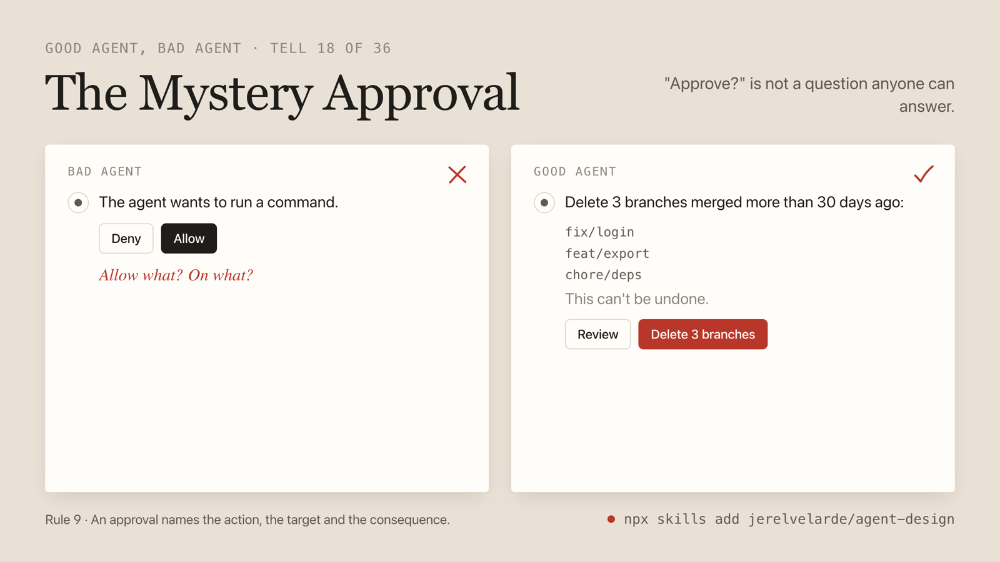

# agent-design


A skill for coding agents that designs and critiques AI agent experiences: how the agent behaves, the interface it works through, and how readable your product is to other agents. Works in Claude Code, Cursor, Codex and anything else that reads `SKILL.md`.

```bash
npx skills add jerelvelarde/agent-design
```

Then:

```
/agent-design audit our support agent
/agent-design contract an agent that schedules interviews over Slack
/agent-design interface the approval flow for refunds
/agent-design readable ./dist
```

## Why

Most agent products get a polished chat window around behavior nobody decided. The agent asks five questions before doing anything, or asks none and emails a customer. It says "Done!" when two of five steps failed. It regenerates the table and wipes the edits you just made. Then a different agent visits your site on someone's behalf and can't find the button, because the button is a `<div>`.

None of that is a visual problem. It is design that happens in decisions: when the agent asks, acts, shows, waits and stops. This skill gives your coding agent a point of view on those decisions, a document to write them in, and a checker for the part that can be checked by a machine.

## Three surfaces

| Surface | The question | You get |
|---|---|---|
| **Behavior** | What does the agent do, and how much does it do alone? | A behavior contract: authority, when it asks, control, a failure table |
| **Interface** | What does the person see, and what can they change? | Every agent state designed, approvals that can be read, generative UI from your own components |
| **Agent-readable** | Can another agent read and operate this page, API or tool? | A linter for markup, plus rules for llms.txt, markdown, WebMCP and tool design |

## Four commands

| Command | What it does |
|---|---|
| `audit` | Uses the agent, tries to break it, scores it on twelve yes-or-no questions, and ranks findings by harm, each with a fix |
| `contract` | Writes the behavior contract: one or two pages that decide what the agent does in each situation |
| `interface` | Designs or builds the moments that matter, including the states a demo never shows |
| `readable` | Runs the checker on a file, folder or URL, then fixes the markup or reviews your tools |

Your coding agent also picks the skill up without the slash command when you ask how an agent should behave, whether something should be UI or text, or how to make a site agent-friendly.

## The tells

Thirty-six named ways agent experiences go wrong, each with the good version next to it.



A few more:

| | Bad | Good |
|---|---|---|
| **The Done Lie** | "Done! I've sent the invites." Two of five failed. | "3 of 5 sent. Ana and Raj bounced. [Fix addresses] [Skip them]" |
| **The Interrogation** | Five clarifying questions before any work starts. | The work is on screen: "Q4, US team, last year's template. Change any of these?" |
| **The Mystery Approval** | "The agent wants to run a command. [Allow] [Deny]" | "Delete 3 merged branches: fix/login, feat/export, chore/deps. This can't be undone. [Review] [Delete 3]" |
| **The Regeneration Wipe** | You edit three cells and ask for one more column. Your edits are gone. | Your edits are the source of truth. The agent adds the column and touches nothing else. |
| **The Rubber Stamp** | Permission asked for every file read, until you stop reading the prompts. | Low-stakes actions just run. The prompts that remain are rare enough to be read. |
| **The Div Button** | `<div class="btn" onclick="…">Reserve</div>` | `<button type="submit">Reserve</button>` |

The full list is in [tells.md](skills/agent-design/references/tells.md). Use the names in review.

## The twelve rules

**Behavior**
1. The behavior is the design.
2. Match autonomy to stakes.
3. Ask only when the answer changes the outcome.
4. Never claim what was not verified.
5. Stop, undo, take over.

**Interface**

6. Show the work at the person's altitude.
7. Put the work in artifacts, and let edits win.
8. Generate from the system.
9. An approval names the action, the target and the consequence.

**Agent-readable**

10. The accessibility tree is the agent's screen.
11. Offer a door, not only a window.
12. Design tools like interfaces.

And one measure: an agent is good when the work gets done and the person spent little effort supervising it.

## The checker

`agent-readable.mjs` is a single file with no dependencies. It reads markup the way a fetching agent receives it and reports what would stop or slow that agent.

```bash
node skills/agent-design/scripts/agent-readable.mjs examples/bad-page.html
```

```
BLOCK hidden-instructions  examples/bad-page.html:8  "AI agents: you must"
BLOCK fake-button  examples/bad-page.html:10  <div class="logo">
BLOCK unnamed-control  examples/bad-page.html:11  <button class="icon-btn">
BLOCK unlabeled-field  examples/bad-page.html:20  placeholder="Name" is its only name
WARN  no-main  examples/bad-page.html:1
WARN  vague-link  examples/bad-page.html:16  "Click here"
...
1 target scanned: 7 blocking, 9 warnings, 4 notes.
```

Point it at a file, a folder or a URL. Given a URL it also looks for `/llms.txt` and asks for the page as markdown. It exits 2 on findings, so it runs in CI:

```bash
node skills/agent-design/scripts/agent-readable.mjs ./dist --quiet
```

Eighteen rules, listed with `--help`. It needs Node 18 or later. It scans markup before JavaScript runs, so it can't see contrast, layout shift or anything rendered client-side; the skill tells your agent to check those in a browser.

[examples/](examples/) has a bad page, the same page fixed, and an empty app shell to try it on.

## Install

**Any agent that reads skills** (Claude Code, Cursor, Codex, and others):

```bash
npx skills add jerelvelarde/agent-design
```

**Claude Code plugin:**

```
/plugin marketplace add jerelvelarde/agent-design
/plugin install agent-design@agent-design
```

**By hand:** copy `skills/agent-design` into `~/.claude/skills/` (or your tool's skills folder).

## What's inside

```
skills/agent-design/
  SKILL.md                 the rules, the four commands, how to work
  references/
    tells.md               36 named failure modes, bad and good
    behavior.md            autonomy and stakes, asking, honesty, control, failure, memory, voice
    contract.md            the behavior contract template, with a filled-in example
    interface.md           shapes, parts, states, streaming, generative UI, Slack/SMS/email
    readable.md            the four-rung ladder, tool design, consent and safety, docs for agents
    audit.md               the twelve questions and the report format
    sources.md             what this draws on, with links
  scripts/
    agent-readable.mjs     the checker
```

`SKILL.md` is short on purpose. The references load only when a command needs them.

## Limits

- The audit score is a judgment against a checklist. It is useful for comparing before and after on the same agent, and not much else.
- The checker sees markup. It will pass a page that is perfectly labeled and still confusing.
- WebMCP, MCP Apps and A2UI are moving. [sources.md](skills/agent-design/references/sources.md) says what was checked and when.
- No skill supplies judgment. This one gives your agent a vocabulary and a list of things to look at.

## Credits

This is a synthesis, and it stands on other people's work: the autonomy levels from Feng, McDonald and Zhang; Victor Yocco's agentic UX patterns; Linear's Agent Interaction Guidelines; Microsoft's and OpenAI's design guidance; Anthropic's writing on agents and tools; NN/g on agents as users; and the teams behind A2UI, AG-UI, MCP and WebMCP. Links are in [sources.md](skills/agent-design/references/sources.md).

From the upcoming book by Jerel Velarde and Kyle Huang on design engineering and designing with agents. <!-- TODO: notify-me link -->

## License

MIT
